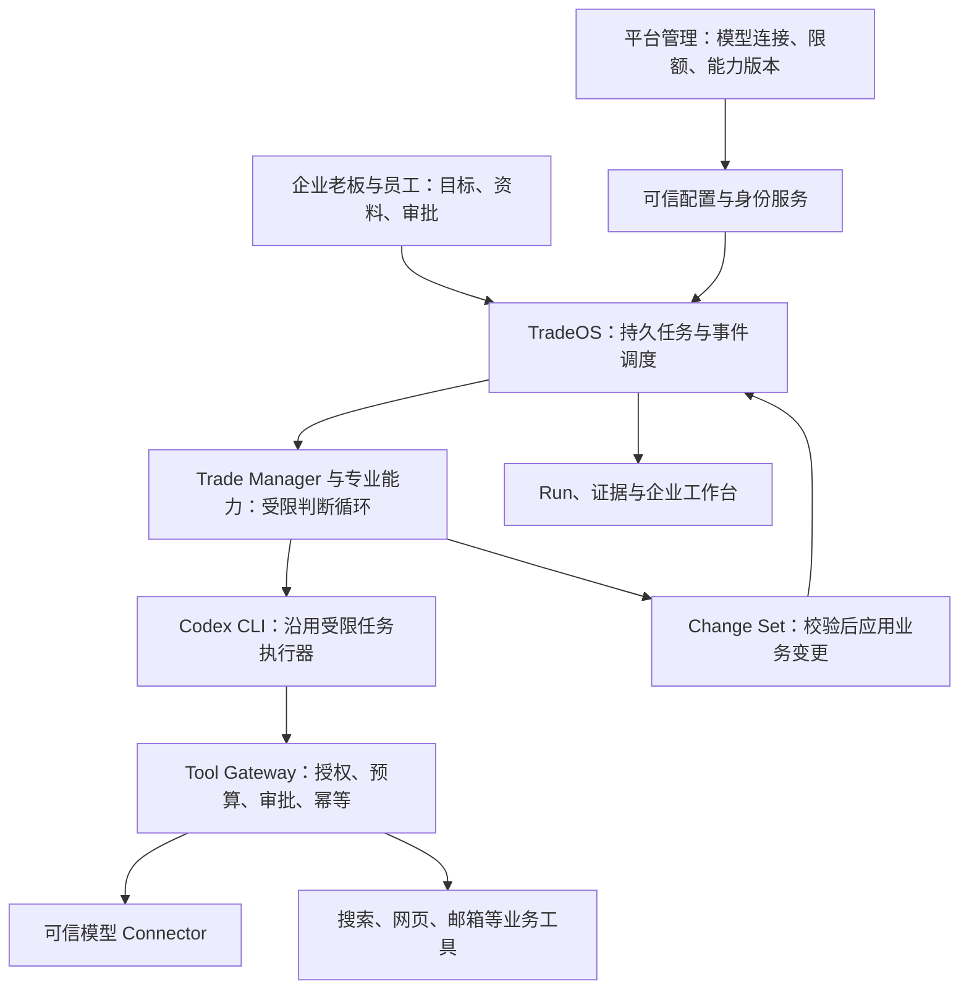

# TradeOS 企业 Agent 整体升级评估

日期：2026-10-21，更新：2026-10-22。状态：产品方向与实施范围已确认；Tasks1–5/7已通过各自门禁，Task6最终集成已形成，整体验证与独立评审状态见[验收记录](../../operations/agent-upgrade-verification.md)。生产发布及真实运营效果未验收。

本文记录已核查的事实、已确认的产品决定和待验证项。用户确认后，业务起点与运行引擎选择已记录到 [ADR 0113](../../adr/0113-product-first-agent-upgrade.md)，并同步总纲及相关规则；九条硬边界和商业审批要求不变。此次完成源码与文档审阅，未安装 PenguinHarness、运行真实模型对照实验或改动生产系统。代码存在不等于已经部署或通过端到端验收。

## 1. 要交付的产品

TradeOS 为每家企业提供一个可持续工作的 Trade Agent。企业设定业务目标后，系统在已授权范围内获取资料、使用工具、判断下一步、等待外部事件，并向负责人交付有证据的结果。

用户确认的主流程：**企业上传自己的资料 → 整理为企业独立的数据并确认产品 → 选择产品、地区等搜索条件 → 自动搜索客户与邮箱 → 验证邮箱并在批准范围内发起联系 → 自动接续普通邮件沟通 → 验证需求、转审批或人工接管。**

资料上传保留原件与来源，提取字段区分已确认、待确认和未知。系统可以帮助整理资料，但不能自行补造规格、价格或认证。企业使用产品、地区等业务条件操作 Agent，无须填写模型 API 或了解框架。

**已确认沿用 Codex CLI。** PenguinHarness 调研保留为参考；接入、替换和对照测试均不属于当前升级任务。

已经明确的权限分工：

| 身份 | 控制范围 |
| --- | --- |
| 平台管理者 | 配置模型 API、选择企业可用的连接版本、管理平台限额与能力发布 |
| 企业老板 | 管理本企业资料、业务目标、员工权限、Campaign 和商业审批；不能管理平台 API 密钥或自行更换模型连接 |
| 企业员工 | 使用获准数据和工具，处理归属自己的客户与贸易机会 |
| Trade Agent | 在上述授权内工作，提出判断与 Change Set，不能自行扩大权限、预算或商业承诺 |

每个企业拥有自己的 Agent，不要求每个企业训练模型权重，也不必每个企业永久运行一套完整服务。独立性首先来自数据、身份、配置、会话、运行记录和工具权限的隔离；物理部署方式另行依据规模与隔离要求决定。

“持续工作”意味着任务状态持久化，由调度、客户回复、人工审批等事件唤醒；没有工作时不需要持续消耗模型调用。

本文将“标准 Agent 能力”落实为可验收行为：理解目标、取得授权上下文、选择工具、读取结果并调整下一步、保存进展、等待与恢复、交付可核验结果。是否采用某个框架不构成验收标准。

## 2. 核查范围与版本问题

本次对照了两份本地源码：

| 来源 | 已知事实 | 使用限制 |
| --- | --- | --- |
| 当前工作区 `/Volumes/T7/Company/Auto_customer_acquisition` | Git HEAD 为 `aebaa9b`，另有未提交的业务改动和文件 | 不能用 HEAD 代表全部工作区状态；不能重置已有改动 |
| 验收源码 `/Users/xueziheng/Documents/Codex/2026-10-19/tradeos-qq-acceptance/receipt-fix/src` | 包含 Codex 桥接、企业模型连接目录等较新的实现与 ADR；该目录本身没有可用的 Git 历史 | 它是验收副本，尚不能据此认定为生产部署或唯一开发基线 |

需要先解决的差异：

1. 业务入口分歧已由用户在本次讨论中解决：企业已确认产品优先。当前总纲、术语及相关规则据此更新，见 ADR 0113；各版本实现是否符合这一入口仍需核查。
2. 当前根总纲保留 Phase 1 的多租户与模型路由限制；验收副本 ADR 0089、0090 已描述平台模型配置和按企业固定选择。固定选择不等于自动模型路由，也不等于多企业运行已经验收完成。
3. 验收副本 ADR 0090 明确：保存企业模型绑定，并不自动赋予该企业 API/worker 的运行身份；不能回退借用另一企业的配置。
4. 两份源码的 ADR 0078、0079 对应不同文件与决策，不能只按编号覆盖。必须按内容、来源和实现引用对照。

下一轮实际开发先建立“工作区—验收副本—部署版本”的文件与迁移对应表，保留现有改动，选定可追溯的基线。这是避免重复开发和回退已有功能的前提。

## 3. 现有能力与升级重点

以下“已有”只表示看到了对应代码或设计证据；未经本次运行验收的部分不标为完成。

| 能力 | 当前证据 | 整体升级要交付什么 |
| --- | --- | --- |
| 业务骨架 | 当前架构已有需求、贸易机会、供应、审批、人工接管等领域 | 保留领域对象与业务链路，建立可供 Agent 使用的能力清单 |
| 企业与员工身份 | 已有 tenant 过滤、角色与客户归属；验收副本 ADR 0081 增加数据库角色和 RLS 设计 | 连同检索、文件、缓存、任务队列、模型配置做跨企业拒绝验收；员工权限变化后及时生效 |
| 平台模型配置 | 验收副本 ADR 0089、0090 与连接实现 | 核实只有平台身份可以配置；任务绑定确切连接版本，恢复沿用原版本，企业不能修改密钥或越权选模型 |
| Agent 交互 | 验收副本 `agent_runtime/assistant/model_decision.py` 支持澄清、业务读取、证据解释、研究提案等受控输出 | 让企业目标可以衔接多个已授权能力；不是只把每个页面操作换成聊天命令 |
| 模型与工具循环 | 验收副本 `connectors/codex_agent/` 已有受限的多轮桥接和部分任务工具 | 统一各业务能力的输入、工具范围、停止条件、失败类型与结果契约；不要假定目前所有能力都可自主组合 |
| 上下文与记忆 | `agent_runtime/assistant/context.py`、`reads.py` 对历史依赖重新授权；另有企业资料处理能力 | 分开保存共享业务事实、个人会话、任务中间结果；长期事实必须有来源、确认状态和版本 |
| 持久任务 | workflows、scheduler、Run 与检查点已有基础 | 覆盖等回复、等审批、断线、重启、权限撤销、预算耗尽；恢复不能重复产生外部副作用 |
| 工具执行 | Tool Gateway、审批、预算与幂等是既有架构核心 | 把可用业务操作显式暴露给 Agent；每次执行由可信代码检查，不靠提示词承诺 |
| 结果与评测 | Run、Change Set、证据链和 `tests/evals/` 已有设计与部分实现 | 用完整业务任务比较运行引擎；UI 显示目标、进度、证据、成本、等待原因和下一步 |

判断：TradeOS 已具备企业 Agent 的重要组成部分。需要补齐的是跨能力的一致运行方式和产品体验，以及整条链路的验收，不能仅凭替换 CLI 宣称完成。

## 4. 建议的整体结构

这张图表示运行时职责，不能据此引入反向依赖。代码仍遵守 `apps → workflows / agent_runtime → domains → shared`，跨域调用按既有边界装配。

### Agent 如何主动工作

企业选择已确认产品、地区等搜索条件后，系统形成可核对的 Boss Directive，明确业务范围、预算、允许的动作和停止条件。对于新 Campaign 等规定动作，完成现有审批；搜索授权不自动等于发送授权。

在一次获准工作中，模型可以根据证据调整搜索问题、选择下一个已授权工具、补充信息或建议人工接管。可信代码验证选择后执行，将结果反馈给模型。达到目标、需要审批、缺少外部信息、权限失效或预算耗尽时停止本次循环，并持久保存原因。

客户回复、审批结果或计划时间到达后，由确定性调度恢复相关工作。模型不自行更改流程定义、业务状态机、租户身份或预算上限。

取得邮箱后先经过可达性验证、抑制名单、发送身份、权限、配额和政策检查。收到回复即停止原开发序列，交由回复流程接续；普通产品说明和需求澄清在授权范围内自动处理，不要求员工逐封点确认。价格、折扣、交期等商业承诺进入既有审批，退订或明确拒绝停止触达。匹配到一家企业不等于验证了其采购意愿。

这与现有“Manager 不编排整条流水线”的原则相容：可变的是某个任务内的判断和工具选择；业务状态转换、调度和授权仍由代码负责。如果最终需要改变这一边界，应另立 ADR。

### 三类数据分开处理

- 企业共享业务资料：按权限读取，事实与推断分离；产品、需求和承诺不能由聊天摘要直接确认为事实。
- 员工 Agent Session：默认绑定发起员工，不能因为同属一家企业就向所有人共享私聊历史。
- Run 中间结果：服务当前任务，关联证据和工具执行；会话恢复时重新检查当前权限，不能用旧历史绕过撤权。

模型连接、技能版本和运行策略按 Run 固定，当前撤权和停用仍有优先效力。新增缓存、检索、Trace 和工件存储也必须有明确的企业归属与访问检查。

## 5. PenguinHarness 调研记录（本轮不采用）

用户已选择沿用 Codex CLI。以下记录解释它如何通过现成运行组件帮助开发 Agent，供日后查阅；不构成接入建议或待办事项。

核查版本：GitHub 提交 `8aa761232bf6a0463c9131cc3cc93038927099ed`。以下是该版本文档与源码能支持的结论，尚未在 TradeOS 中运行验证。

| 已核实能力 | 对 TradeOS 的用途 | 不能据此推定的能力 |
| --- | --- | --- |
| 可嵌入 TypeScript SDK，`createAgent` 与 `session.run` | 复用模型调用、工具反馈和继续执行的循环 | 安装 SDK 就能获得完整企业产品 |
| Session 恢复、上下文压缩与 Trace | 保存执行过程、帮助定位中断与模型行为 | 自动保证跨天业务事务、幂等发送和企业数据隔离 |
| LLM 与 Environment 接口、工具扩展 | 研究如何接入 TradeOS 的模型桥接和业务工具 | 所有内置工具默认都适合生产开放 |
| 运行截止原因、取消信号和工具审批接口 | 映射到 TradeOS 的取消、失败、审批等待与恢复 | 普通 allow/deny 回调能替代完整商业审批 |
| 评测与 Agent 优化工具包 | 离线比较提示词、技能和工具描述的候选版本 | 自动改动线上权限、业务规则或生产技能 |

主要依据：[SDK](https://github.com/Prism-Shadow/penguin-harness/blob/8aa761232bf6a0463c9131cc3cc93038927099ed/packages/docs/content/quickstart-sdk.zh.md)、[运行循环](https://github.com/Prism-Shadow/penguin-harness/blob/8aa761232bf6a0463c9131cc3cc93038927099ed/packages/docs/content/agent-loop.zh.md)、[接口](https://github.com/Prism-Shadow/penguin-harness/blob/8aa761232bf6a0463c9131cc3cc93038927099ed/packages/docs/content/interfaces.zh.md)、[会话与记录](https://github.com/Prism-Shadow/penguin-harness/blob/8aa761232bf6a0463c9131cc3cc93038927099ed/packages/docs/content/sessions-and-traces.zh.md)、[优化工具包](https://github.com/Prism-Shadow/penguin-harness/blob/8aa761232bf6a0463c9131cc3cc93038927099ed/plugins/default-rsi-toolkit/skills/agent-optimization/SKILL.md)。

接入时必须解决的具体差异：

1. **语言与进程。** SDK 要求 Node.js 24 或以上；TradeOS 后端为 Python。可评估独立 Node 服务加类型化协议，但会增加部署、取消传播、日志关联和状态同步的工作量。是否值得要靠对照验证。
2. **预算与重试。** Penguin 的循环默认可以不限轮数，并带模型重连策略。不能直接继承这些默认值；需要总轮次、时间和费用预算，以及用量未知时的停止规则。模型重试与工具副作用重试必须分开。
3. **审批。** `pre_tool_use` 钩子可以提前作出允许决定，从而不再调用宿主审批回调。因此 TradeOS 的最终授权必须在不可由 Agent 修改的 Gateway 内执行；不能只挂一个审批回调。
4. **凭证与工具。** 官方快速示例读取共享配置并全部允许工具，仅适合理解 SDK。生产适配须保留可信模型桥接，隔离真实凭证；关闭或严格限制通用 shell、文件访问和直接网络能力。工具清单过滤是否覆盖所有路径需要实测。
5. **持久化。** Penguin 会话和 Trace 不替代 TradeOS 的 Run、业务库与审批记录。Agent 状态或文件快照也不能撤回已经发送的邮件；恢复和补偿策略必须由业务执行层负责。
6. **自我优化。** 优化只产出离线候选；固定测试样本与独立保留样本，评分和费用由代码计算。生产采用经评审的版本，不能让 Agent 修改自身权限、预算或事实判定规则。

“100 倍”不是本项目已验证的收益。当前证据只能说明可复用能力确实存在，不能证明它比现有运行器更快、更省或更准确。

## 6. 三条技术路线

| 路线 | 好处 | 代价 | 建议 |
| --- | --- | --- | --- |
| 完善现有 Codex CLI 适配与统一能力契约 | 保留已做的模型桥接和业务约束，迁移较少 | 自己维护部分循环、上下文和观测能力 | 用户已选择 |
| 在相同契约下试接 Penguin SDK | 可复用通用循环、会话与评测能力 | 新增 Node 运行环境和适配，仍需业务治理 | 本轮不采用、不安排试接 |
| 将产品整体迁到 Penguin 的应用与存储 | 可快速体验其通用 Agent 功能 | 企业治理、业务状态与现有界面需要大量重新整合 | 本轮不采用 |

验收副本把 Codex CLI 配置为临时、受限的任务执行器，这有利于控制权限；企业的长期任务由上层业务系统保存。当前沿用它完成业务接入与验收，不再把框架选择作为前置问题。

建议先把业务能力与运行引擎解耦到现有允许的接口边界。若插件点不足以支持，先记录所需核心变化并讨论，不以“只是换框架”为由绕过总纲。

## 7. 整体实施顺序与交付标准

### 第一批：统一基线与能力地图

交付代码来源对应表、当前部署与迁移清单、业务工具清单、已实现/已接入/已验收矩阵，以及需要更新的 ADR 列表。以已确认的产品驱动决定核查实现，解决编号冲突，保留已有功能和用户改动。

完成标准：每项保留能力都能找到实现和验证依据；每个缺口都有所属模块；根规则和实际实施目标一致。不能把“文档里写了”标成“已经可用”。

### 第二批：建立统一的企业 Agent 运行方式

围绕现有 Boss Directive、Agent Session、Agent Turn、Run 和 Change Set，统一授权上下文、工具选择、预算、取消、等待、恢复与结果事件。先复用已有字段和契约，不直接新建另一套任务系统。

完成标准：同一目标可以跨多次模型调用和外部事件继续工作；浏览器关闭不丢任务；预算耗尽停止；权限撤销后不继续执行；无权限的工具无法调用；重启不会重复发信或重复应用变更。

### 第三批：把业务能力接成完整体验

覆盖企业资料上传与确认、产品和地区等搜索条件、发现与研究、邮箱获取与验证、获批触达、自动回复沟通、需求验证、贸易机会与人工接管、进度解释。每个环节都通过同一权限、任务和证据体系。

供应匹配、正式报价和成交处理按已确认的项目阶段接入；不能因为 Agent 能调用工具就把阶段外能力自动开放。新 Campaign、价格邮件与其他商业承诺沿用规定审批。

完成标准：企业从一个目标看到执行进度、已取得证据、已验证需求、待处理事项和成本；无需在各功能页面反复搬运上下文。聊天中的“完成”必须能对应已提交的业务结果。

### 第四批：验收 Codex CLI 与完整业务流程

沿用现有 Codex CLI，在统一任务契约下验证工具能力、上下文、输出校验和恢复。先用模拟工具验证拒绝与恢复，再用固定历史样本验证任务质量，最后在明确配额与发信范围内做真实试点；不引入 Penguin 对照任务。

用例与评估资产统一进入 `tests/evals/` 及现有对应测试目录，覆盖跨企业读取拒绝、凭证不可见、撤权、提示注入、工具失败、长时间等待、重启、取消、重复事件和审批不能绕过。邮件用例还须覆盖同一会话持续回复、客户回复后原序列停止、退订和商业承诺转审批。记录任务交付质量、耗时、模型与工具费用、人工接管负担。

完成标准：业务与隔离条件通过，结果可追溯；企业上传的资料能正确支持选定产品的客户开发，邮件沟通可持续且不会重复发送或越权承诺。API 连接成功不替代完整 Agent 与邮件流程验收。

### 第五批：多企业验收与发布

使用至少两个企业身份和不同员工范围验证从登录、检索、文件、工具到运行恢复的隔离。界面显示平台模型配置与企业业务设置的权限差异。保留可回退的已验收版本，按企业与能力逐步启用。

完成标准：停用一个企业或一个连接版本不会借用其他企业资源继续运行；部署回退不抹掉已提交业务状态；后台能解释每次失败与成本归属。验收不能只靠数据库中存在 tenant_id。

## 8. 成功怎么衡量

沿用唯一北极星：每消耗一单位成本产生的合格贸易机会数。研究发现的公司、推断出的需求、生成的邮件都不能直接计为合格贸易机会。

为解释该结果，另外记录阶段交付成功率、错误与重复动作、人工接管时间、模型与数据工具费用、等待时长、运行恢复结果。供应与利润尚未人工确认时，单独报告已验证需求，不夸大成完整贸易机会。

需纳入成本的变量还包括数据源购买、邮箱信誉维护、企业资料整理、人工审批和支持、跨语言运行环境维护。模型更换或工具增加可能提高能力，也可能增加耗时和错误机会，需要同条件比较。

## 9. 本轮结论与尚未确定事项

已确认保留 TradeOS 业务体系并沿用 Codex CLI，围绕“企业资料与已确认产品 → 条件搜索获客 → 邮箱验证与自动沟通 → 已验证需求及人工接管”完善产品。PenguinHarness 仅保留调研记录，本轮不接入。

本轮已确认业务入口、主流程、产品角色、模型管理边界和运行引擎。实际编码前仍需统一权威代码基线，并将接入缺口收敛为明确范围的实施规格。无须让企业用户选择框架、填写模型 API 或理解这些内部实现。

## 10. 执行中确认的搜索调整（2026-10-22）

用户要求主搜索使用 Codex CLI 与 DeepSeek 自有搜索能力，Tavily 保留为可选获客源，不再作为必需依赖；获客源验收优先对免费或有免费额度的来源进行少量只读实测。此调整不授权真实邮件发送或生产部署。

官方资料当日核实：DeepSeek 已提供独立 Search/Fetch API；Responses 服务端 web_search 当前仅 deepseek-v4-pro 支持，Flash 忽略此工具，且 max_tool_calls 参数不生效。独立搜索接口可供 Codex 受限工具循环调用，不能把“CLI 能运行”当成“已经真实搜索”。平台仍决定每个企业的模型/API，升级不得静默替换已有企业模型。

官方中文计费说明注明：Search/Fetch 按成功且非空的请求计费，每千次 5 元；DeepSeek Harness/Claude Code/Codex 服务端工具调用目前未计费，2026-11-01 00:00（北京时间）起按次收费。模型 token 费用与搜索请求费用分别核对。实测时重新确认当前额度与价格，不能把限时免搜索费写成永久免费模型运行。

依据：[搜索与抓取](https://api-docs.deepseek.com/zh-cn/guides/search/)、[Responses 兼容性](https://api-docs.deepseek.com/zh-cn/guides/responses_api/)、[Codex 接入](https://api-docs.deepseek.com/quick_start/agent_integrations/codex/)。实现与实际可用性由新增 Task 7 验收，本文记载要求和官方能力，不代表已接通。
